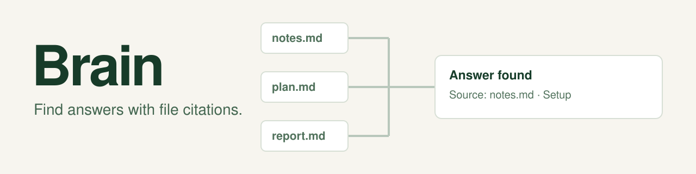

# Brain

Brain searches notes and project documents on your computer. Use it to find an answer and the file that supports it. Results show when the index was last updated. Once installed, Brain searches offline.

Start by previewing installation after [installing Go 1.27.1](#requirements):

```sh
./scripts/install --source /path/to/notes --skills codex,claude
```

Sections: [Install and first search](#install-and-first-search), [What install writes](#what-install-writes), [Requirements](#requirements), [Network](#network), [What Brain reads and writes](#what-brain-reads-and-writes), [Commands](#commands), [Develop and release](#develop-and-release), [Remove](#remove).

## Install and first search

1. Clone this repository and open its folder. Supply Go 1.27.1 as shown in [Requirements](#requirements).
2. Replace `/path/to/notes` with the folder you want Brain to read. Preview the install:

   ```sh
   ./scripts/install --source /path/to/notes --skills codex,claude
   ```

3. Review the printed `skill_files`, `backups_dir`, `settings_file`, and `daily_job` (its name, time, and files). Apply the same choice:

   ```sh
   ./scripts/install --source /path/to/notes --skills codex,claude --write
   "$HOME/.local/bin/brain" search "your keywords"
   "$HOME/.local/bin/brain" --version
   ```

To install the executable in another folder, use the same `--bin-dir` choice for the preview and installation:

```sh
./scripts/install --source /path/to/notes --skills codex,claude --bin-dir "$HOME/bin"
./scripts/install --source /path/to/notes --skills codex,claude --bin-dir "$HOME/bin" --write
"$HOME/bin/brain" search "your keywords"
```

Repeat `--bin-dir "$HOME/bin"` when upgrading this installation. The full executable path works without changing your shell settings.

The installed agent skills run `brain` by name. Add the chosen folder to your command path so that agents can use them. For the default folder, this setting works in the current terminal. Add the same line to your shell profile to keep it:

```sh
export PATH="$HOME/.local/bin:$PATH"
brain --version
```

## What install writes

The installer builds Brain, copies it to `~/.local/bin/brain` by default, records your source, indexes it, copies the selected agent skills, and registers daily indexing. Use `--skills none` to skip agent skills, or `--no-schedule` to skip the daily job. A preview leaves installed destinations unchanged but may download Go modules and create build cache files. [Install details](docs/reference.md#what-install-writes), [upgrades](docs/reference.md#upgrades), and [daily indexing](docs/reference.md#daily-indexing) explain these changes. Source documents stay unchanged.

A normal build reports version `0.1.0-dev`. No tag or GitHub release exists. [Release steps](docs/build-and-release.md#portable-builds-and-archives) are separate from first use.

## Requirements

Brain runs on macOS; Windows and Linux builds are experimental.

The built executable needs no Go toolchain, model, service, or network connection. Building this checkout needs Git, a POSIX shell, and Go 1.27.1. Windows builders can use Git Bash and the pinned Windows toolchain. Git is optional during normal use.

Download Go 1.27.1 from the [official Go releases page](https://go.dev/dl/), then install it once on your computer. Make `go` available on your command path. Check the version and build:

```sh
go version
./scripts/build
```

The version must say `go1.27.1`. Brain checks it before building, so every build uses the same compiler. A newer Go patch release is refused until the project moves its pin. To choose another Go installation for this checkout, put its absolute installation folder in the ignored `.local/go-root` file:

```sh
mkdir -p .local
printf '%s\n' '/absolute/path/to/go1.27.1' > .local/go-root
./scripts/build
```

That folder must contain `bin/go` and `bin/gofmt`. On Windows with Git Bash, use a Git Bash absolute path such as `/c/Go/go1.27.1`. Delete `.local/go-root` to use `go` on your command path again. Brain does not copy or download the Go compiler. Go uses pinned module versions in `go.mod` and `go.sum`. The first install or `./scripts/build` may download those modules. Later builds reuse `~/.cache/brain/go-mod-cache` by default. `XDG_CACHE_HOME` and `GOMODCACHE` can change that location. The built Brain executable works offline.

## Network

Building can download pinned Go modules. Once built, Brain makes no model or network calls, including while indexing and searching. [Build details](docs/build-and-release.md) explain offline rebuilds.

## What Brain reads and writes

Brain reads only sources you select. A bare `brain init` selects only the current folder. Brain indexes Markdown (`.md`), RTF (`.rtf`), and Word (`.docx`) files. It skips other file types, such as `.txt`, without a message. `brain index` refreshes the stored index; search reads that index without reopening source files. The optional daily job runs indexing. Use `brain sources add`, `move`, or `remove` to change sources, then run `brain index`. [Source rules and search behavior](docs/reference.md#manage-sources-and-rules) give examples.

Brain does not read Claude Code memory folders unless you add them. To add each current memory folder, run:

```sh
for folder in "$HOME"/.claude/projects/*/memory; do
  brain sources add "$folder" --project claude-memory
done
brain index
```

Run the loop again after Claude Code creates memory for a new project.

Brain skips common secret files before reading them and removes recognized tokens and private keys before storing text. It cannot identify every secret. Search citations still identify original files, which another program with access can read. [Privacy limits](docs/reference.md#protect-secrets) and the [redaction catalogue](internal/redact/CATALOGUE.md) give details.

The default state folder holds the index, notes, and run records. It is `~/Library/Application Support/Brain` on macOS, `%LOCALAPPDATA%\Brain` on Windows, and `$XDG_DATA_HOME/brain` or `~/.local/share/brain` on Linux. Set `BRAIN_HOME` to select another state folder. [State selection and relocation](docs/reference.md#state-folders) explain changes. The installer also writes its selected binary, agent skills, and daily job. It saves the selected state folder in `selection.json`, inside `~/Library/Preferences/Brain` on macOS, `%APPDATA%\Brain` on Windows, and `$XDG_CONFIG_HOME/brain` or `~/.config/brain` on Linux. It keeps replaced files in `~/.local/share/brain-install-backups`. It does not edit shell profiles or agent hook settings.

## Commands

```sh
brain search "lease timeout" --format json
brain show CHUNK_ID --format json
brain index --format json
brain sources list --format json
brain status --format json
brain doctor --format json
brain schedule status --format json
```

Exit code 0 means success, 1 means a problem, and 2 means the command line was invalid. Exit code 3 means nothing needed to change: `brain doctor` exits 3 when healthy, and `brain index` exits 3 when no file changed. Scripts should treat 3 as success.

Search results include a chunk ID for `show`, a source citation, and `index_age_s`. A reported index gap means some results may be outdated. Run `brain doctor` for recovery guidance. [Command behavior and examples](docs/reference.md#search-and-refresh) cover notes, maps, schedules, and agent setup.

## Develop and release

Run `./scripts/check` and `./scripts/verify fast` after development changes. The verifier records evidence under `.local/verify/`. [Contributing](CONTRIBUTING.md) lists full checks. [Builds and future releases](docs/build-and-release.md) cover five targets, packaging, and platform limits. Brain is released under the MIT License and is provided as is, without warranty. See [LICENSE](LICENSE). Report sensitive security issues through [SECURITY.md](SECURITY.md).

## Remove

[Removal steps](docs/reference.md#remove) preserve saved notes until you choose to remove them.
